<h1 align="center">Lettertide</h1>

<p align="center"><b>Letters that arrive right on time.</b><br>
Write to future you, to someone special, or to Santa (who writes back).<br>
Simple enough for a seven-year-old. Meaningful enough for their grandparents.</p>

<p align="center">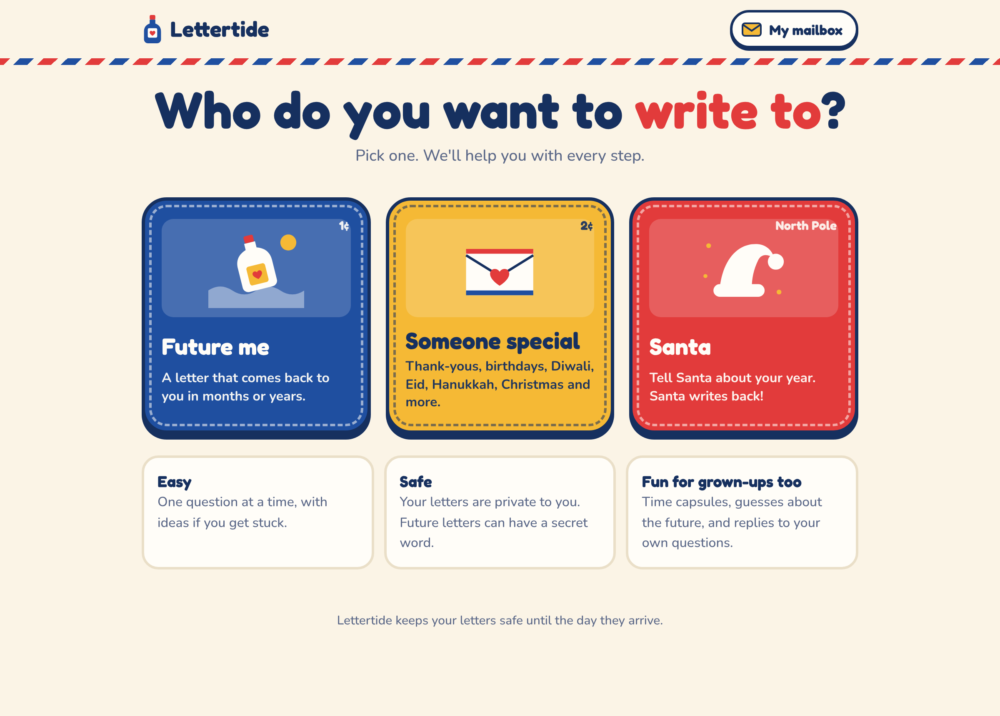</p>

---

## Why Lettertide exists

Most of us remember the feeling of finding an old note we wrote years ago: the handwriting, the worries that turned out fine, the dreams that came true or quietly changed. Letters slow time down.

Websites that send a letter to your future self already exist, but they are mostly built for adults: a plain text box, a date picker, and an email years later. Children want to write letters too, to grandparents at Thanksgiving, to a teacher who helped them, to Santa in December, and to the person they'll be when they grow up. They need something they can finish on their own, that feels like a toy rather than a form, and that keeps their words safe.

Lettertide brings every letter that matters into one bright, friendly place, where a child can finish a letter without help and a grown-up still finds something meaningful.

## How Lettertide is different

| | A typical future-letter site | Lettertide |
|---|---|---|
| **Who you can write to** | Yourself | Future you, anyone you love, and Santa |
| **Made for** | Adults who like to write | Kids and grown-ups: one question per screen, big buttons, idea starters, talk instead of typing, and read-aloud |
| **Look and feel** | A form | A real letter: airmail stripes, stamps, handwriting, and a bottle floating out to sea |
| **When it arrives** | One date, one email | Months to 100 years later, on Thanksgiving, on any day, or right now |
| **What comes back** | The letter | The letter, a time capsule shown "then and now", a guess to check, and a "write back" button that keeps the conversation going |
| **Santa** | Not included | Santa replies right away, with child-safe rules built in |
| **Cards for others** | Usually not included | Cards for festivals across cultures and everyday moments, delivered on the day under the writer's name, and replies go back to the family |
| **Built to last** | Depends on one email address | The whole letter travels inside the arrival email, a yearly "still you?" check, an optional backup contact, and a full export |
| **Privacy** | Varies | Optional secret word that encrypts the letter in your own browser |

### What makes it special

- **Three kinds of letters, one home.** Future me, Someone special, and Santa all live in the same mailbox.
- **Talk instead of typing.** Kids who can't write yet tap the microphone and say their letter; it appears as written sentences. A **Read it to me** button reads Santa's reply and arrived letters out loud for kids who can't read yet.
- **Made for small hands.** One question at a time, giant tap targets, a progress trail of dots, and idea buttons like *"Right now I love…"* or *"This year I'm thankful for you because…"* for when a child gets stuck.
- **Letters that answer back.** A future letter brings back a time capsule (favorite food, best friend, what I want to be) beside empty boxes for who you are now, asks whether your guess came true, and lets you write back to the future.
- **Santa writes back, safely.** Santa never promises a specific present, never asks for an address or school, never suggests keeping secrets, and gently tells a child to talk to a trusted grown-up if they mention being hurt or scared.
- **Cards for every culture's big days.** Diwali, Eid al-Fitr and Eid al-Adha, Hanukkah, Christmas, Kwanzaa, Lunar New Year, Holi, Raksha Bandhan, Pongal and Sankranti, Thanksgiving, Mother's and Father's Day, plus everyday thank-yous and birthdays. Each festival comes with its own greetings, colors and sticker (a diya for Diwali, a crescent moon for Eid, a menorah for Hanukkah, a lantern for Lunar New Year), and Lettertide works out the date so the card arrives on the day.
- **Sent as you, answered to you.** Grandma sees the card from "Maya via Lettertide", and when she taps Reply, it goes straight to Maya's family.
- **An airmail look.** Red-and-blue airmail stripes, envelope cream and stamp yellow on every screen and every email, with the three choices drawn as postage stamps. It works in light and dark mode.

---

## A quick tour

### Future me

Write to future you, pick when it comes back, and pack a time capsule.

<p>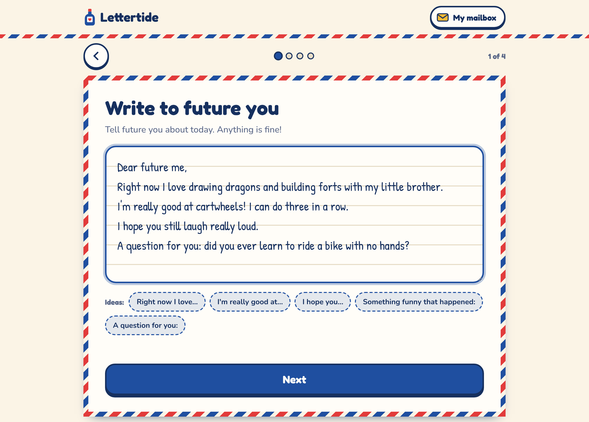 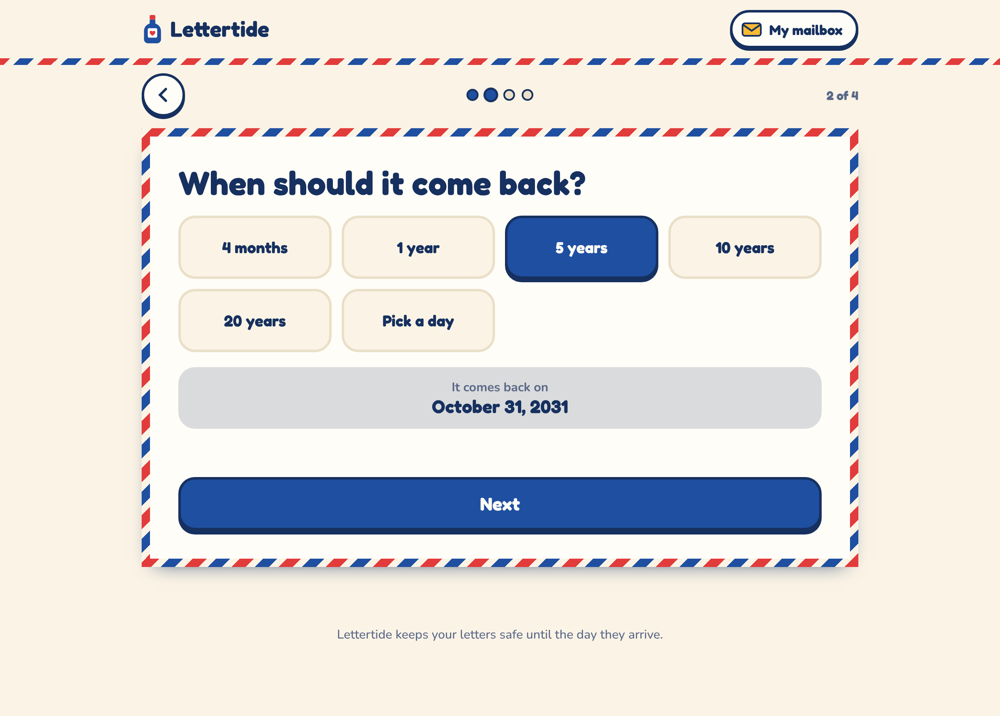</p>
<p>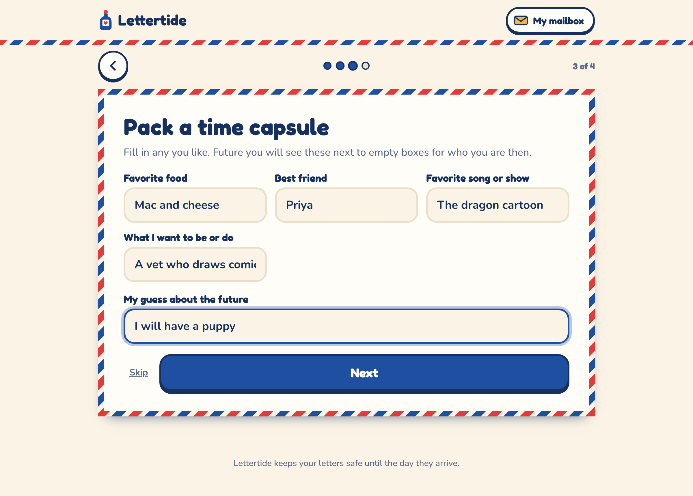 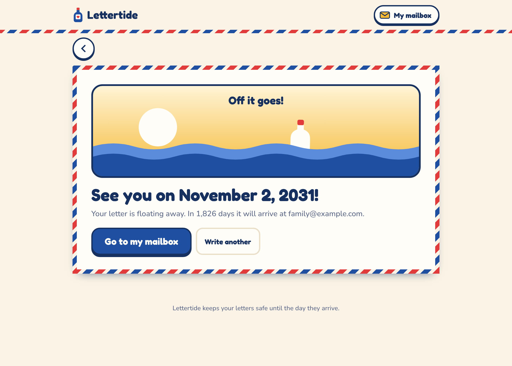</p>

Years later, the letter washes ashore with everything you packed:

<p align="center">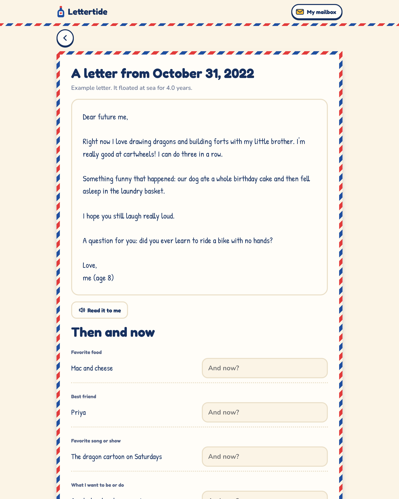</p>

### Someone special

Make a card, decorate it, and send it now or on the day that matters.

<p align="center">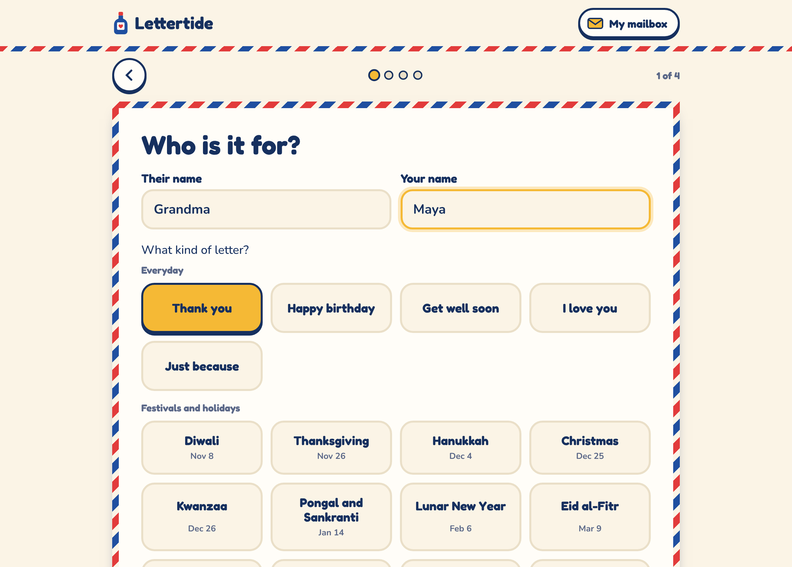</p>

<p>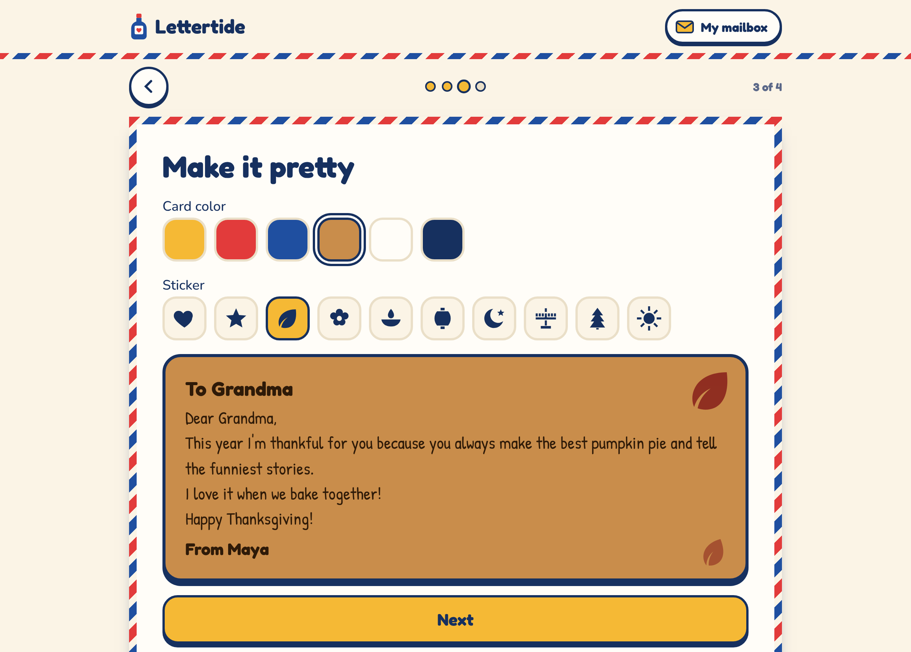 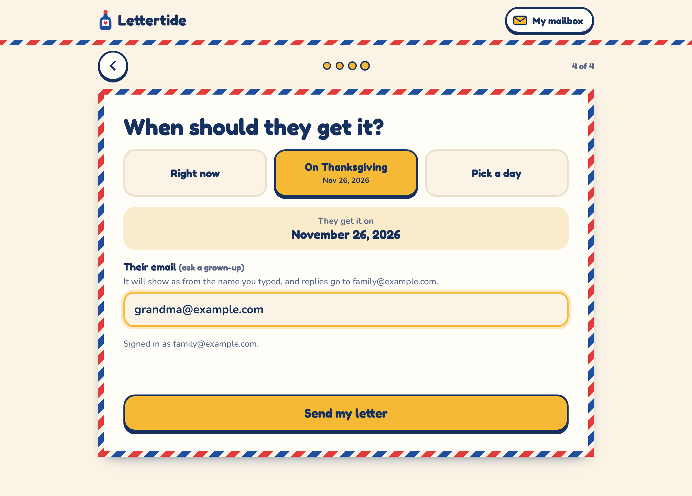</p>

What Grandma receives in her inbox:

<p align="center">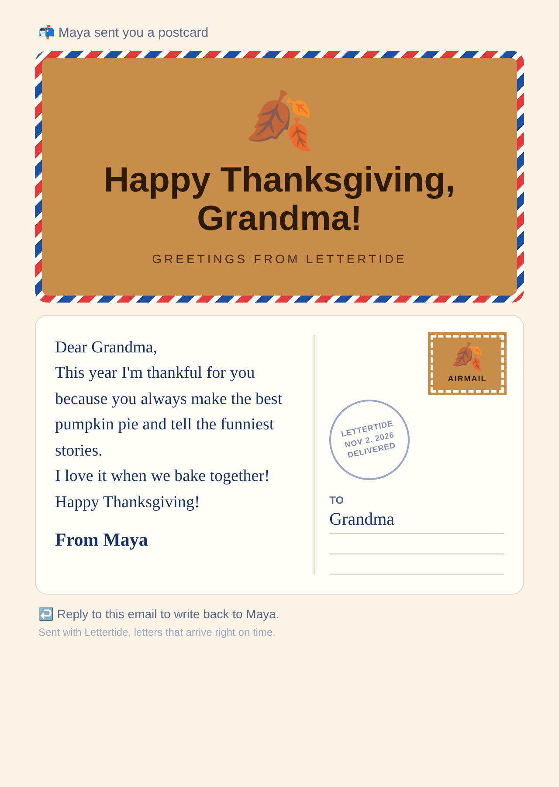</p>

### Santa

Tell Santa about your year. An envelope flies to the North Pole, and Santa writes back.

<p>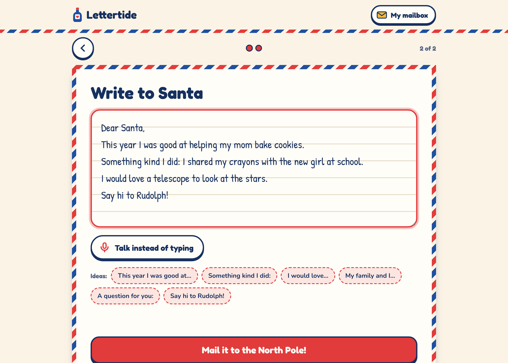 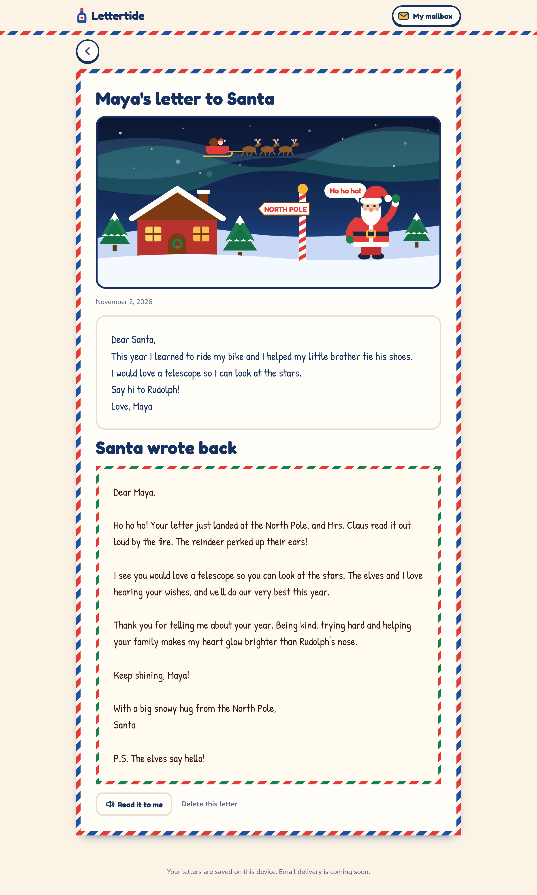</p>

### My mailbox

Every letter in one place: floating to the future, arrived, Santa's replies, and cards for people.

<p align="center">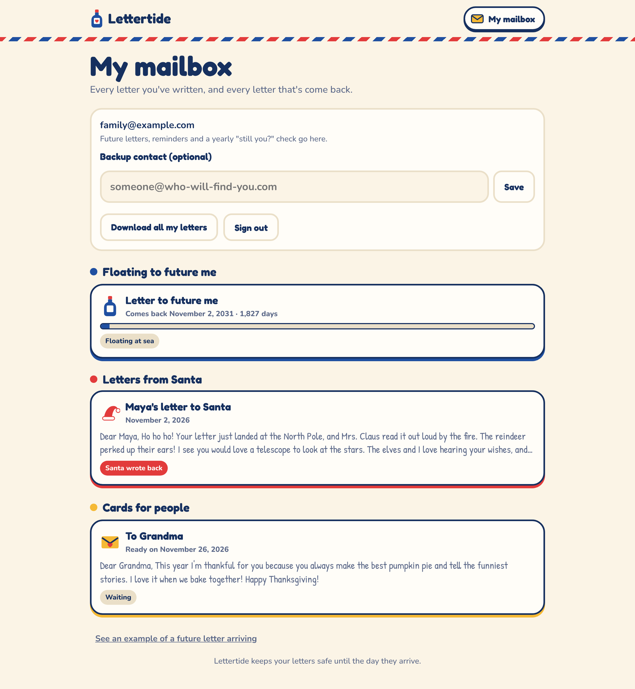</p>

### On a phone, in dark mode

<p align="center">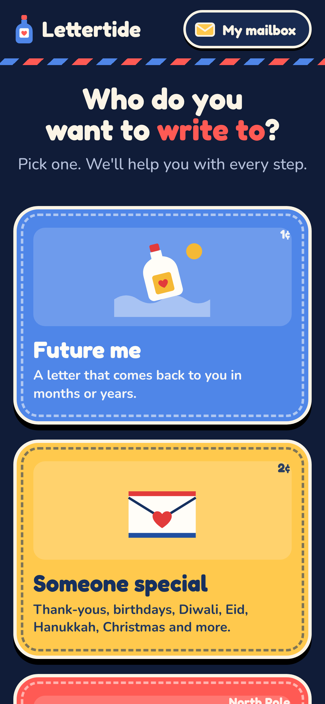&nbsp;&nbsp;&nbsp;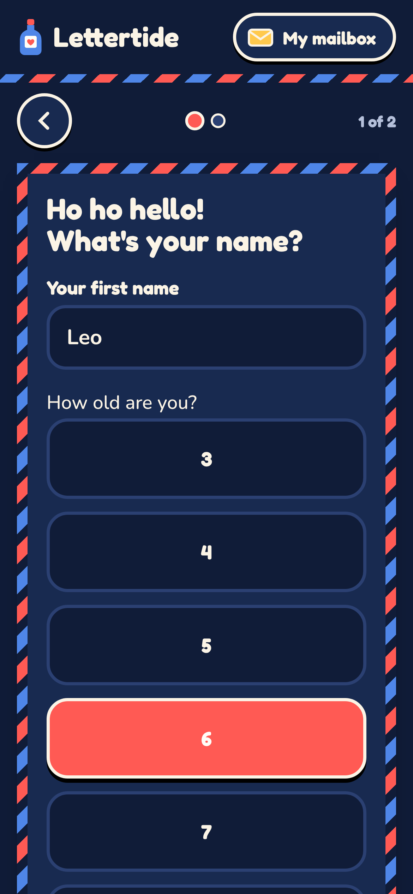</p>

---

## Safety and privacy

- **Grown-ups sign in** with an email link (no passwords to remember). Kids never need an account of their own.
- **Secret-word letters** are encrypted in the browser (AES-256) before they are saved. Without the word, nobody can read them, including whoever runs the server.
- **Santa's rules** are fixed on the server and can't be changed by what a child types.
- **No spoofed email.** Cards are sent from Lettertide under the writer's name with Reply-To set to the family's email, so they don't get blocked as fake mail.
- **Limits** on sign-in emails, cards (20 a day) and Santa replies keep it from being misused.
- **Your data is yours.** Download every letter at any time, or delete your account and everything in it.

## How it works

- **Website:** one HTML page (no framework) with a step-by-step wizard for each kind of letter.
- **Server:** Node.js with Express.
- **Storage:** a free [Turso](https://turso.tech) database (SQLite in the cloud). Locally it uses a plain SQLite file.
- **Email:** a free Google Apps Script on your Gmail (`google-apps-script/send-mail.gs`), so emails come from a real Gmail account. Any SMTP provider also works on hosts that allow it.
- **Delivery:** [cron-job.org](https://cron-job.org) (free) calls `/api/cron/deliver` every 10 minutes. That sends whatever is due (arriving future letters, scheduled cards, yearly check-ins) and keeps the free server awake.
- **Santa:** writes personal replies with Claude when an Anthropic API key is set; otherwise a warm ready-made reply is used.

## Run it on your computer

Requires Node.js 22.13 or newer.

```bash
npm install
npm start          # open http://localhost:3000
npm test           # end-to-end check of every feature
```

Without email settings, emails are printed in the terminal, so you can copy the sign-in link from there.

## Put it online for free

Everything below has a free plan. Total cost: $0.

1. **Database (Turso):** sign up at turso.tech with GitHub, create a database called `lettertide`, and copy its URL (`libsql://…`) and a database token.
2. **Email (Google Apps Script):** go to script.google.com with the Gmail you'll send from, create a new project, paste in `google-apps-script/send-mail.gs`, change `SECRET` to a long made-up phrase, run `testSend` once to approve it, then **Deploy → New deployment → Web app** (Execute as: Me, Who has access: Anyone) and copy the web app URL.
3. **Website (Render):** in the Render dashboard open **Blueprints → New Blueprint Instance**, pick this repository, and fill in:
   - `BASE_URL`: your site address, for example `https://lettertide.onrender.com`
   - `DATABASE_URL` and `DATABASE_TOKEN`: from Turso
   - `MAIL_WEBHOOK_URL`: the web app URL; `MAIL_WEBHOOK_SECRET`: the same phrase as `SECRET`
   - `ANTHROPIC_API_KEY`: optional

   `CRON_SECRET` is created for you.
4. **Scheduler (cron-job.org):** create a free job that opens `https://YOUR-SITE/api/cron/deliver?key=YOUR-CRON_SECRET` every 10 minutes. Copy `CRON_SECRET` from the service's Environment page on Render.

Free plans have limits: Gmail sends up to 100 emails a day through Apps Script, and Render's free plan sleeps if the scheduler stops. For a bigger audience, move to a paid Render plan and an email service with your own domain; nothing else changes.

## Project structure

```
public/index.html   the whole website
server.js           sign-in, letters API, delivery worker
db.js               storage (Turso in production, a file locally)
google-apps-script/ free Gmail mail sender
mailer.js           email sending and email designs
santa.js            Santa's replies and safety rules
test/smoke.js       end-to-end test of every feature
render.yaml         one-click setup on Render
docs/screenshots/   the pictures in this README
```
